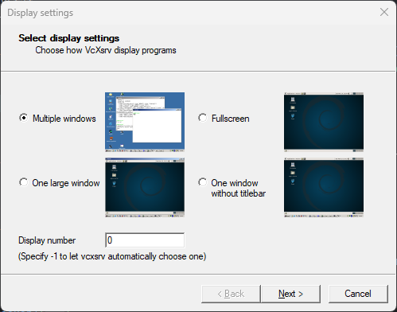
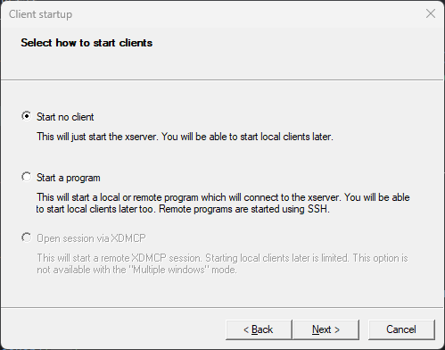
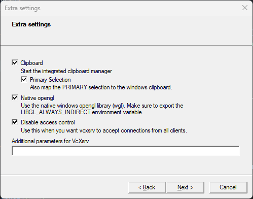
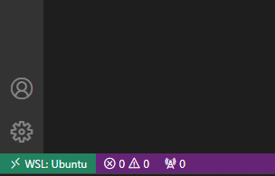

# 191.119 Autonomous Racing Cars (2026S) - Lecture WS

This repo provides you with a setup for developing with ROS2 in Docker.
It contains the F1Tenth simulator and a basic structure for developing your own nodes.

If you have no experience with Docker, we recommend this guide to get start: <!--TODO: link-->

Please feel free to further improve the layout of the workspace to your needs.
If you think an essential change would also greatly benefit other students, please create a merge request, and we will review the changes and, if they are beneficial, merge them.

If you have questions or discover things that are not working, open an issue or write your problem in the TUWEL forum.

## Table of Contents

 - [Structure](#structure)
 - [MS Windows](#ms-windows)
    - [X-Server](#x-server)
    - [Invalid Username](#invalid-username)
    - [Docker in WSL](#docker-in-wsl)
 - [macOS](#macos)
 - [Usage](#usage)
    - [docker-compose](#docker-compose)
    - [VSCode devcontainer](#vscode-devcontainer)
    - [JetBrains devcontainer](#jetbrains-devcontainer)
       - [X-Forwarding](#x-forwarding)
  - [Starting the Simulator](#starting-the-simulator)

## Structure

This workspace contains two different ways to run the simulator and develop with Docker:

- `docker-compose` comparably plain solution, graphical tools use a browser based VNC client to display windows
- `devcontainers` works with VSCode and JetBrains IDEs, launches the docker container and runs the IDE in the container, uses the native window system

The workspace uses the following directory structure:

```
.
├── docker-compose.yml -> file used by docker-compose
├── Dockerfile -> general Docker image description
├── get_env.sh -> script to print the environment (nice to have for JB IDEs & CMake)
├── maps -> mounted to /arc2026/maps/ in container
├── README.md
└── src -> mounted to /arc2026/ws/src/your_code/ in container
```

In addition, there are two hidden (at least on *nix systems) directories.
The `.cache` directory contains a build cache to improve build times.
The `.devcontainer` directory contains configuration files for `devcontainer`s.

Please note that all Docker-based approaches use `Dockerfile`.
Changes to any of the approaches in this file, will also be present in other environments.

Due to limited accessibility to MS Windows machines at the workgroup, we cannot guarantee compatibility with MS Windows.
If you have persistent problems with MS Windows, consider using a Virtual Machine with the Manual Installation instruction from `Lab 1`.

## MS Windows

> The steps and troubleshooting discussed in this section are only relevant, iff your host OS is MS Windows.
> If you use GNU/Linux you can disregard this section.

Docker is a system designed around the Linux kernel.
With WSL and some tricks, similar results are achievable in MS Windows.
We document some known issues with this environment and MS Windows in this section.

There are two options to use docker under MS Windows:
1. [Docker Desktop](https://docs.docker.com/desktop/install/windows-install/): Runs a virtual Linux environment in which it runs Docker
    
    Run Steps [X-Server](#x-server) and, if necessary, [Invalid Username](#invalid-username)
2. [Docker in WSL](#docker-in-wsl): Install `Ubuntu` (or any other distribution) in WSL and in there install `docker`
    
    See steps highlighted in corresponding section.

### X-Server

Running graphical applications in docker on MS Windows requires running an X-Server (graphics server for Unix-like systems).
For this we recommend to install [VcXsrv](https://github.com/Martin1994/vcxsrv-wsl/releases/tag/1.20.1.4-wsl-patch) which installs an X-Server and configuration for WSL.

Before you can run any graphical applications you have to run `xlaunch`.
You can access this either with the *Start Menu* or in the installation directory (by default `C:\Program Files\VcXsrv`)

On launch, you will see these three screens to configure the X-Server.
(Screenshots by Mihai-Teodor Stanusoiu)





### Invalid Username

A common error with using MS Windows occurs, when the username contains spaces or other characters not allowed in Linux usernames.
This usually manifests in the following step (check the log for this command):

```dockerfile
RUN groupadd --gid $USER_GID $USERNAME \
    && useradd --uid $USER_UID --gid $USER_GID -m $USERNAME \
    #
    # [Optional] Add sudo support. Omit if you don't need to install software after connecting.
    && apt-get update \
    && apt-get install -y sudo x11-apps \
    && echo $USERNAME ALL=\(root\) NOPASSWD:ALL > /etc/sudoers.d/$USERNAME \
    && chmod 0440 /etc/sudoers.d/$USERNAME
```

Other errors might also cause this command to fail.

To fix this error, open the `devcontainer.json` file you are using and change the occurrences of `${localEnv:USER}` (occurs 3 times) to a valid Linux username.
Valid Linux usernames (or a subset thereof) are alphanumeric without spaces. (e.g. `ros`)

### Docker in WSL

**Dependencies**:

+ `Ubuntu` (or any other distribution) in WSL (via the Microsoft Store)

First, install docker in `Ubuntu`.
You should be able to start `Ubuntu` via the *Start Menu*.

```shell
sudo apt-get update
sudo apt-get upgrade
sudo apt-get install docker docker-compose
```

Restart `Ubuntu` and clone this repository in WSL.

```shell
git clone ssh://git@gitlab.tuwien.ac.at:822/cyber-physical-systems/lehre-public/arc2026/lecture-workspace.git
```

Navigate to the lecture workspace and start VSCode:

```shell
code
```

Press `Ctrl + Shift + P` and type `Connect to WSL` into the bar at the top.
If you have multiple operating systems installed, select `Connect to WSL using Distro...` and select `Ubuntu`.
If you only have `Ubuntu` select `Connect to WSL`.
You should now see that you are connected to `WSL Ubuntu` in the bottom right corner of VSCode.



Open the workspace directory in VSCode and navigate to `.devcontainer/.devcontainer-windows-wsl-direct`.
Press `Ctrl + Shift + P` and execute `Dev Container: Rebuild and Reopen in Container` for the first build and when you updated the container.
For other times, simply execute `Dev Container: Reopen in Container`.

This will take some time.
VSCode will then open up again in the `devcontainer`.
Subsequently opened terminals and will be opened inside the `devcontainer` and can access all programs you need for ROS2.

After this point, you can continue with [Starting the Simulator](#starting-the-simulator).

## macOS

For `macOS` only the [docker-compose](#docker-compose) version has been tested.
If other versions work, please let us know, s.t. we can update the guide accordingly.

### macOS problems with real car

Users of `macOS` using the docker solution will notice a problem with messages not being received/ transmitted.

You can verify the problem exists by running this command on your car:
```shell
ros2 multicast recv
```
and this command on your machine
```shell
ros2 multicast send
```

If the car does not see your sent message, you will be unable to communicate via ros2. The problem is due to how `macOS` limits the network access to the docker container, e.g. there is no 'network_mode=host' like on linux.

If you stil want to develop on your car and view ros2 messages, you can use a third party viewer as alternative to rviz. We recommand the tool `foxglove`. It is free to use and even has a webbrowser version.

To use foxglove install the ros2 foxglove bridge on the car. This component essentially subscribes to each ros2 topic and is able to publish the default messages via websocket.
```shell
sudo apt install ros-$ROS_DISTRO-foxglove-bridge
```
then launch the foxglove bridge on the car:
```shell
ros2 launch foxglove_bridge foxglove_bridge_launch.xml
```

The navigate to https://foxglove.dev/ and login using google or create a new account. Once you are in foxglove click on 'connect to new source' and connect to your car.

If you need more help, view the foxglove guide on how to set up and use foxglove: https://docs.foxglove.dev/docs/connecting-to-data/frameworks/ros2

## Usage

If possible for you, we recommend to use `devcontainer`s with either VSCode or a JetBrains IDE.
VSCode is a free source code editor by Microsoft.
Students (and employees) of TU Wien can apply for academic licenses for JetBrains' all products pack, which includes CLion and PyCharm, which are full-fledged IDEs for C++ and Python respectively.

Alternatively, you can use `docker-compose`, which is just the bare system, without a source code editor or an IDE.

### `docker-compose`

**Dependencies**:
(also refer to ([https://docs.docker.com/engine/install](https://docs.docker.com/engine/install/) )

+ `docker`
+ `docker-compose`

To set up the system, first clone the repository.

```shell
git clone ssh://git@gitlab.tuwien.ac.at:822/cyber-physical-systems/lehre-public/arc2026/lecture-workspace.git
```

First, build the Docker image and pull all required images.
Execute this command in the `lecture-workspace` directory.

If you prefer X-Forwarding over using VNC in the browser, add the option `-f docker-compose-x11-fwd.yml` after `compose` in the following two commands.
You might need to additionally execute the steps in [X-Forwarding](#x-forwarding).

```shell
docker compose build
```

To start the environment, run the following command in the same directory.

```shell
docker compose up
```

This will start two containers, one for the display server and one that contains the simulator.

You can access the simulation container with (in another terminal):

```shell
docker exec -it lecture-workspace-sim-1 /bin/bash
```

Execute the above command every time you need a new terminal session.

To see the graphical environment open [http://localhost:8000/vnc.html](http://localhost:8000/vnc.html) and click on `Connect`.

Alternatively you can use the docker-compose file `docker-compose-x11-fwd.yml` (instead of `docker-compose.yml`) that uses direct X11-forwarding to the host machine.

### VSCode `devcontainer`

**Dependencies**:
(also refer to ([https://docs.docker.com/engine/install](https://docs.docker.com/engine/install/) )

+ `docker`
+ VSCode
+ Remote Development Extension in VS Code

To set up the system, first clone the repository.

```shell
git clone ssh://git@gitlab.tuwien.ac.at:822/cyber-physical-systems/lehre-public/arc2026/lecture-workspace.git
```

**If the command above does not work and tells you that you have no permissions to clone the repository, you can also download it manually as a .zip directly from gitlab.** E.g. go to [this](https://gitlab.tuwien.ac.at/cyber-physical-systems/lehre-public/arc2026/lecture-workspace) link in your browser, then click on "Code" and then "Download source code, zip". To avoid this error and the manual downloading in the future, consider adding an SSH key to your gitlab account: [https://docs.gitlab.com/user/ssh/](https://docs.gitlab.com/user/ssh/)

Navigate to the `.devcontainer/devcontainer.json` (`.devcontainer/.devcontainer-windows/devcontainer.json` in MS Windows) file.
Then use `View>Command Palette...` for the command `Dev containers: (Re-)build and Reopen in Container`.
This will initialize and start the `devcontainer` in VSCode.

After VSCode is finished with loading and set up, open a terminal in VSCode.
From now on, we will use the shell in this terminal to execute the commands.

### JetBrains `devcontainer`

**Dependencies**:
(also refer to ([https://docs.docker.com/engine/install](https://docs.docker.com/engine/install/) )

+ `docker`
+ JetBrains IDE of your choice (EAP versions recommended!)

Navigate to the `.devcontainer/devcontainer.json` (`.devcontainer/.devcontainer-windows/devcontainer.json` in MS Windows) file.
Click on the devcontainer icon (3D-ish cube) in the Gutter (next to the line numbers) and select `Create Dev Container and Mount Sources`.
After building has completed, the tool window will show a selection of IDE backends.
Pick the one corresponding to the IDE you intend to use and press `Continue`.
This will start a new instance of the IDE with a connection to the `devcontainer`.

#### X-Forwarding

JetBrains IDEs do not support the use of `--net=host` for docker.
It is therefore necessary to disable this but also to open up your X Server.

Run this to disable authorization on your X-Server

```shell
xhost +
```

**CAUTION:** This allows any and all hosts from anywhere to use your X-Server (graphical interface) to display windows on your PC! **UNDER NO CIRCUMSTANCES do this on an untrusted network!**

In the lower left if the JetBrains IDE window, click on the Terminal symbol to open the terminal tool window.
From now on, we will use these to execute commands.

## Starting the Simulator

Before you can run the simulator you need to build the workspace to make all packages in it available to you.
Make sure you run this in `/arc2026/ws/`.

```shell
source /opt/ros/jazzy/setup.bash
colcon build
```

The first command sets up the ROS2 environment in your current session and makes everything from the global workspace available.
The second command invokes the build tool used in ROS2 called `colcon` to build all packages.

After the build is finished you can run the simulator:

```shell
source install/setup.bash
ros2 launch f1tenth_gym_ros gym_bridge_launch.py
```

The first command sets up the workspace located at `/arc2026/ws/` and makes all packages (initially only the simulator) in that workspace available to you.
The second command uses the ROS2 launch system to start the simulator and all dependencies.

This will output a lot of warning messages during the startup of the simulator:

```text
[rviz2-1] Warning: Invalid frame ID "map" passed to canTransform argument target_frame - frame does not exist
[rviz2-1]          at line 133 in /tmp/binarydeb/ros-foxy-tf2-0.13.14/src/buffer_core.cpp
```

You can ignore these messages.

After the messages have stopped flooding your terminal session, you should see the car in a visualization window (`rviz2`) and the lidar sensor visualized as colorful points along the wall.
To move the car, you can use the package `teleop_twist_keyboard` that is already installed in the container.
Run the following commands in a new(!) terminal session to start the keyboard control.

```shell
source install/setup.bash
ros2 run teleop_twist_keyboard teleop_twist_keyboard
```

You can now (very crudely) control your car with your keyboard.
